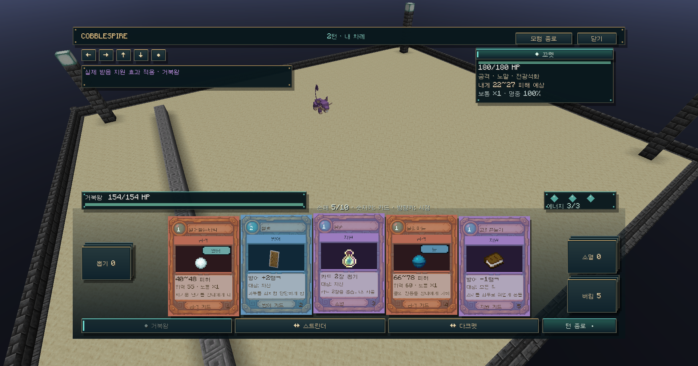
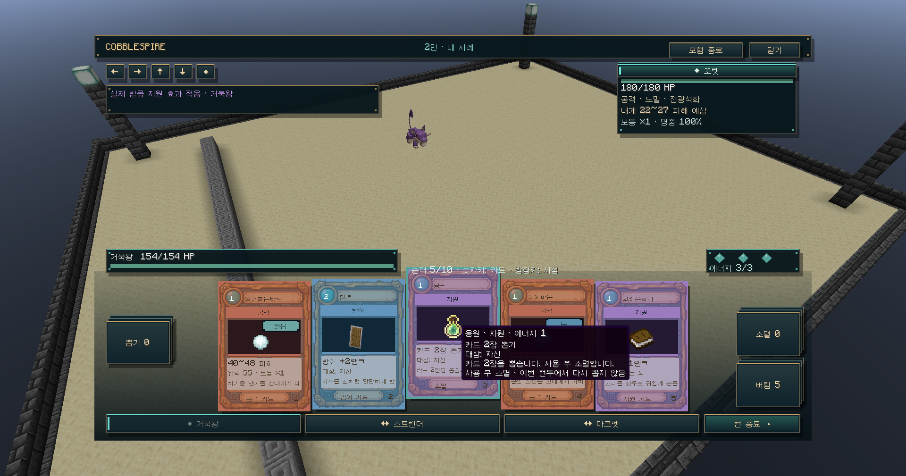
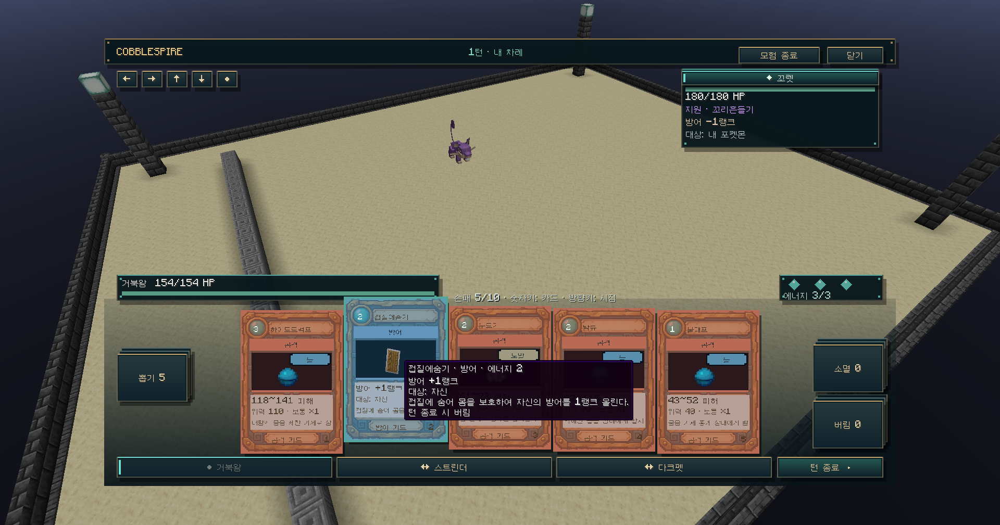

# 카드 역할과 타입 태그 · 0.5.1-dev

카드의 역할과 기술 타입을 분리했습니다. 분류는 카드 UI/스냅샷 표시용이며 실제 피해·비용·기술 효과는 변경하지 않습니다.

| 역할 | 카드 바탕/테두리 | 분류 |
|---|---|---|
| 공격 | 주황 | 직접 피해가 있는 기술. 흡수/부가 효과가 있어도 직접 공격이면 공격 카드 |
| 방어 | 파랑 | 직접 회복 또는 자신의 방어/특방/회피 강화 |
| 지원 | 보라 | 응원/드로우/상태 변화/그 밖의 강화·약화. 칼춤은 직접 피해가 없어 지원 |

공격의 기술 타입은 별도의 태그로 표시합니다. 물/얼음 기술도 주황색 공격 카드이며 태그만 각 타입의 색상입니다. 방어·지원 카드는 공격 타입 태그 대신 역할 이름과 대상/효과를 보여줍니다.

## 응원 등 비공격 카드 수정

서버는 비공격 카드에 위력·명중·타입·적 대상 피해 예측 필드를 보내지 않습니다. 클라이언트 툴팁도 공격/비공격 행을 분리하여 이전 형식 데이터가 들어와도 응원에 공격 정보를 붙이지 않습니다.

응원: `지원 / 에너지 1 / 카드 2장 뽑기 / 대상: 자신 / 사용 후 소멸`. 강화된 응원은 실제 뽑는 장수 3장을 기준으로 설명합니다.

껍질숨기·철벽: `방어 / 대상: 자신 / 방어 +1 또는 +2랭크`. 적의 꼬리흔들기도 `지원 / 방어 -1랭크 / 대상: 내 포켓몬`으로 구분합니다.

## 검증

단위/회귀 테스트 59개와 독립 서버 검사 32개가 통과했습니다. 비공격 페이로드의 공격 필드 부재, 과거 잘못된 데이터가 포함된 응원 툴팁에서도 공격 행이 나오지 않는지, 방어/지원/흡수 공격 분류를 검사했습니다. 실제 개발 클라이언트에서 세 역할의 손패와 응원·껍질숨기 툴팁을 확인했습니다.

프로토콜 6이므로 서버/클라이언트 버전을 맞춥니다. 운영 서버와 실제 Modrinth 프로필에는 설치하지 않았습니다. 기존 월드 경기장/협동/복구 검증의 범위는 이전 문서와 같습니다.
