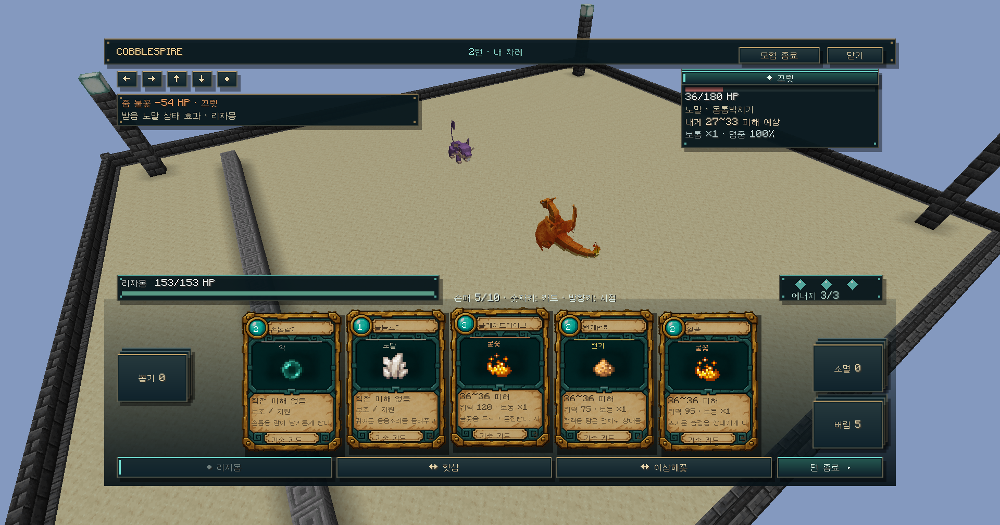
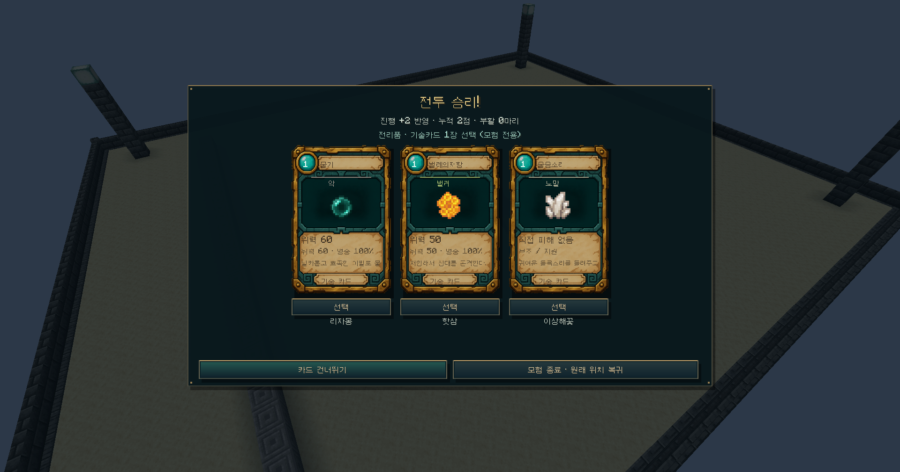

# 전투 피드백 · 0.5.0-dev

## 카드와 적 행동 예고

카드 앞면에 타입, 기본 위력과 현재 선택한 적에게 줄 예상 HP 감소를 표시합니다. 적 선택을 바꾸면 해당 대상의 타입/특성/능력치/남은 HP로 계산한 값으로 바뀝니다. 강화 카드와 다수 대상 보정도 서버의 실제 계산 함수를 사용합니다. 특성/타입 무효는 0, 지원 카드는 직접 피해 없음 또는 드로우 장수로 구분합니다.

예상 범위는 명중했을 때의 비급소 피해입니다. 명중률·상성 배율은 호버 상세에서 확인합니다. 마비 등 행동 실패, 급소, 실제 난수 결과와는 구별합니다. 표시 수치는 현재 대상의 남은 HP를 넘지 않습니다.

적의 행동 HUD에는 기술 타입·이름, 내 현재 출전 포켓몬이 받을 예상 피해, 상성, 명중률을 표시합니다. 보조 기술은 직접 피해 없음으로 표시합니다. 좌상단 최근 판정은 실제로 적중해 줄어든 HP와 타입을 구분합니다. 잔여 독/화상 피해 등 모든 간접 피해를 기술 적중 기록에 포함한 것은 아닙니다.

## 승리와 전리품

전투가 끝나면 중앙 결과 화면으로 전환합니다. 승리/패배를 명확히 표시하고, 승리 시 진행점수 +2와 부활 수, 전리품 선택을 보여줍니다.

- 세 후보는 서버가 한 번 생성합니다. 현재 파티의 각 포켓몬에게 배움표와 효과 호환성이 확인된 기술카드 하나씩을 제시합니다. 원본 덱에 없는 기술을 우선합니다.
- 한 장을 고르면 해당 포켓몬의 모험용 원본 덱에 추가합니다. 다음 전투에 이어지며 실제 파티/PC/인벤토리는 바꾸지 않습니다.
- 카드 선택을 건너뛸 수 있습니다. 선택/건너뛰기 후에만 다음 전투가 열립니다. 중복 요청은 두 번째 카드를 지급하지 않습니다.
- 패배에는 승리 보상이 없습니다. 재접속 런 복원, 화폐/상점/유물/도구 보상은 이번 구현 범위가 아닙니다.

## 검증

실제 개발 클라이언트에서 카드 81~96 예측→90 HP 감소, 54~64 예측→54 HP 감소, 적 노말 몸통박치기 27~33 예고를 확인했습니다. 승리 팝업 자동 표시와 한 장 선택, 나머지 후보 어둡게 표시, 다음 전투 덱 10→11장(손패 5+뽑기 6)을 확인했습니다.

최종 작은 창 에너지 배치와 지원 카드 툴팁 문구는 빌드 검사 범위이며, 위 캡처는 최대화 화면의 검증입니다. 서버 정산/예측 검증은 `validation/stage5-native-checks.json`, 전체 결과는 `validation/stage5.json`을 참고하세요. 프로토콜 5로 서버/클라이언트 버전을 맞춥니다.
