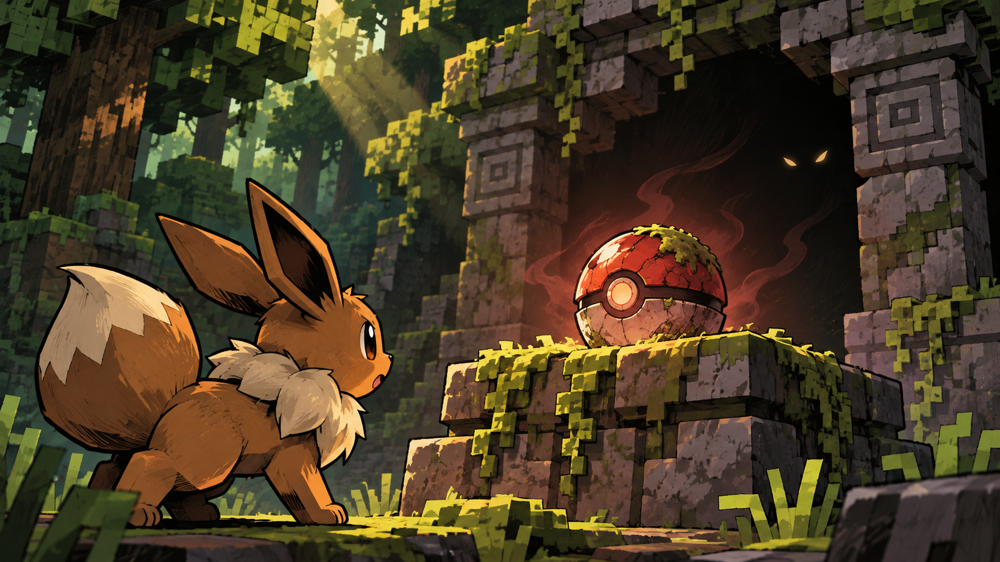

# 이벤트·스토리 이미지 제작 인계서

## 목적과 기준 이미지

이 문서는 다른 이미지 제작 시스템이나 아티스트에게 전달하는 제작 명세다. 게임 UI가 아닌 **이벤트 장면 삽화**를 제작한다. 기준 느낌은 [수상한 몬스터볼 샘플](art_reference/event_pokeball_concept.png). 슬레이 더 스파이어와 다키스트 던전의 이벤트에서처럼 하나의 사건과 선택 직전의 긴장을 한눈에 보여주되, 두 게임의 실제 그림·캐릭터·화면을 복제하지 않는다. 샘플의 이브이와 몬스터볼은 분위기를 보여주는 가상 예시이며 확정된 이벤트가 아니다.



## 반드시 구분할 사항

- 아래 21개 조우 ID와 적 구성은 `design/data/encounter_21.json`에 있는 **기획 데이터**다. 실제 게임 구현·모드팩 호환성 검증 완료를 뜻하지 않는다.
- 물음표 이벤트의 개별 이야기·보상·조건은 확인된 데이터에 구체적으로 정의되어 있지 않다. 아래 물음표 장면은 **기획 후보**이며 콘텐츠 확정 후 제작한다. `registry_events_conditions_actions.json`의 이벤트 ID는 규칙 처리 신호이지 개별 이야기 목록이 아니다.
- 진화·영입·휴식·상점 등은 기능 범위에 해당하며, 그림 속 사건·등장 포켓몬·진화 분기·보상은 기획 승인이 필요하다. 이 문서는 참가 자격이나 효과를 결정하지 않는다.
- 적 진영은 포켓몬만 보여준다. 원본 조우 데이터의 `present_trainer_entity: false`에 맞춰 트레이너나 악역 조직 사람을 그리지 않는다. 조직 정체성은 장소와 소품으로 전달한다.

## 공통 아트 디렉션

**느낌:** 포켓몬 모험의 호기심과 로그라이크의 선택 직전 긴장. 사건이 불길할 수 있지만 잔혹한 공포·피·고어는 배제한다. 매 장면이 독립된 이야기의 한 컷이어야 한다.

**표현:** 손으로 그린 듯한 강한 잉크 윤곽, 각진 형태, 거친 음영과 깊은 명암. 마인크래프트의 블록형 지형·나무·돌·소품과 Cobblemon에 어울리는 포켓몬을 조화시킨다. 포켓몬은 알아볼 수 있는 색·실루엣·특징을 유지한다. 실제 게임 스크린샷이나 과도한 사실주의가 아닌 사건 중심의 삽화다.

**구성:** 하나의 주제와 1~3개의 중요한 요소를 크게 배치한다. 선택의 원인이 되는 대상·위험·인물을 읽을 수 있어야 하며 지나치게 복잡한 배경을 피한다. 장면 전체가 한 이미지에 완결되고, 전경·중경·배경에 깊이를 둔다. 기본 16:9 가로 구도, 제작 기준 1920×1080 이상 PNG. 실제 표시 비율은 UI 확정 전이므로 주 피사체를 중앙 70% 안에 배치해 가장자리가 잘려도 핵심이 남도록 한다. UI의 위치를 가정해 빈 공간을 강제하지 않는다.

**제외:** 글자·숫자·로고·말풍선·버튼·HUD·테두리·가격·선택지, 워터마크, 타 게임의 자산 복제. UI와 문구는 게임이 별도로 표시한다. 이미지 자체는 불투명 배경을 기본으로 한다. 참가 자격·선택 비용·실제 결과를 그림에 확정하지 않는다.

**팔레트:** 1막은 녹슨 갈색·숲 녹색·앰버, 2막 마그마는 화산 적갈색·주황, 아쿠아는 해저 청록·짙은 남색, 3막은 남색·보라·차가운 청록. 휴식과 회복은 같은 환경에서 따뜻한 빛을 강조한다. 환경의 세부 형태는 기획에서 확정된 사실이 아니라 연출 제안이다.

## 생성 요청 공통 템플릿

```text
용도: CobbleSpire 이벤트/조우 장면 삽화, UI 없는 단일 이미지
장면 ID: <아래 ID> / 상태: <기획 데이터 연결 또는 후보>
사건: <선택 직전의 상황 한 문장>
피사체: <정확한 포켓몬 종·형태 또는 확정 전이라고 표기>
구도: <위치·행동·시선과 초점>, 전경·중경·배경
배경: <블록형 장소와 이야기 소품>
분위기·색: <감정, 조명, 막 팔레트>
표현: 굵은 잉크 윤곽, 각진 형태, 거친 음영, 포켓몬 모험과 미스터리
출력: 16:9, PNG, 1920×1080 이상, 주 피사체 중앙 70%
제외: UI, 글자, 로고, 워터마크, 트레이너 사람, 고어, 다른 게임 그림 복제
```

확정 전의 사건을 사실로 만들지 않도록 이름·종·비용·결과가 불명인 곳은 임의로 채우지 않고 시안으로 표시한다. 동일 인물·포켓몬이 여러 장면에 반복된다면 형태와 색을 일관되게 유지한다.

## 삽화가 필요한 위치: 이야기·물음표·시설

다음 ID는 **이 문서 전용 제안 ID**이며 아직 게임 데이터 ID가 아니다. 장면과 사건은 기획 후보로만 사용한다.

| 제안 ID · 표시 위치 | 사건과 핵심 구도 | 배경·느낌 | 생성된 시안 파일 |
|---|---|---|---|
| STORY-ACT1 · 1막 시작 | 작은 포켓몬 실루엣 앞에 오래된 출입구와 갈라진 길 | 숲과 블록형 폐허, 호기심·첫 탐험 | [story_act1.png](art_reference/events/story_act1.png) |
| STORY-ACT2-M · 2막 마그마 경로 시작 | 붉게 빛나는 바위 너머 먼 산을 바라보는 포켓몬 | 화산 암벽과 희미한 연기, 뜨거운 위험 | [story_act2_m.png](art_reference/events/story_act2_m.png) |
| STORY-ACT2-A · 2막 아쿠아 경로 시작 | 물가의 포켓몬이 잠긴 유적을 발견 | 절벽·물·침수된 블록, 신비와 탐색 | 대기 |
| STORY-ACT3 · 3막 시작 | 포켓몬이 낯선 석조 장치와 하늘의 빛을 올려다봄 | 차가운 폐허와 보랏빛 하늘, 고조되는 긴장 | 대기 |
| EVENT-MYSTERY-BALL · 물음표 | 샘플처럼 포켓몬이 수상한 몬스터볼을 발견 | 이끼 낀 제단과 그늘, 호기심과 불확실성 | [event_pokeball_concept.png](art_reference/event_pokeball_concept.png) |
| EVENT-WILD-MEETING · 물음표/영입 후보 | 길을 막은 야생 포켓몬과 탐험 파티가 서로 살핌 | 숲길 또는 동굴 입구, 경계하되 따뜻함 | [event_wild_meeting.png](art_reference/events/event_wild_meeting.png) |
| EVENT-LOST-SUPPLIES · 물음표 후보 | 낡은 상자와 근처의 포켓몬 발자국, 상자 안은 가림 | 버려진 블록형 야영지, 발견과 경계 | [event_lost_supplies.png](art_reference/events/event_lost_supplies.png) |
| EVENT-ROCKFALL · 물음표 낙석 후보 | 균열 난 바위 아래 포켓몬이 안전한 길을 찾음 | 좁은 블록형 계곡, 떨어지기 직전의 긴장 | [event_rockfall.png](art_reference/events/event_rockfall.png) |
| EVENT-SHRINE · 물음표/진화 후보 | 미확정 포켓몬이 빛나는 고대 문양을 바라봄 | 오래된 사당, 신비. 특정 진화나 보상 암시 금지 | [event_shrine.png](art_reference/events/event_shrine.png) |
| EVENT-ENCOUNTER · 전투 발생형 물음표 후보 | 정체를 알 수 없는 포켓몬의 눈과 대치하는 실루엣 | 가려진 숲·동굴, 위험 예고. 적 종은 기획 확정 후 | [event_encounter.png](art_reference/events/event_encounter.png) |
| FACILITY-SHOP · 상점 | 포켓몬이 정리된 여행 물품과 교환대를 살핌 | 블록형 천막·선반, 친근한 탐험 쉼터. 가격·사람 제외 | [facility_shop.png](art_reference/events/facility_shop.png) |
| FACILITY-REST · 휴식 | 포켓몬이 안전한 모닥불 곁에서 쉬는 장면 | 블록형 야영지, 따뜻하고 평온함. 실제 회복량 암시 금지 | [facility_rest.png](art_reference/events/facility_rest.png) |
| FACILITY-TREASURE · 보물볼 | 손이 닿기 직전의 닫힌 보물볼과 주변 단서 | 작은 제단, 기대와 불확실성. 특정 도구 노출 금지 | 대기 |
| RESULT-ACT-CLEAR · 막 완료 | 전투 후 새 길을 바라보는 포켓몬의 뒷모습 | 해당 막 배경, 안도와 다음 여정 | 대기 |
| RESULT-RUN-CLEAR · 최종 완료 | 높은 곳에서 지나온 지역을 바라보는 포켓몬 | 새벽빛, 성취와 희망 | 대기 |
| RESULT-RUN-DEFEAT · 패배 | 지친 포켓몬이 안전한 장소로 돌아가는 뒷모습 | 저녁빛과 조용한 분위기, 상해·고어 없이 여운 | 대기 |

선택 결과에 별도 이미지가 필요한지는 실제 이야기 분기 확정 후 결정한다. 결과를 미리 단정하는 전후 장면을 임의로 제작하지 않는다.

## 전투 조우 이미지 인계: 21개 실제 기획 ID

표의 ID는 `design/data/encounter_21.json`과 직접 대응한다. 각 행을 개별 요청으로 사용할 수 있다. 공통 템플릿에 아래 인물·장면을 추가하고, 정확한 종과 수를 유지한다. 이미지에는 트레이너 사람을 넣지 않는다. 일반전은 대치, 엘리트는 위협을 강조, 보스는 위압적인 구도를 사용한다. 서로 다른 ID를 동일 그림으로 취급하지 않는다. 제작 우선순위는 실제 사용 계획을 확정한 뒤 조정한다.

| 조우 ID | 정확한 적 포켓몬 | 장면 요청 | 생성된 시안 파일 |
|---|---|---|---|
| ACT1-R01 | 꼬렛 | 숲속 낡은 보급 상자 옆에서 고개를 드는 꼬렛, 조심스러운 첫 조우 | [encounter_act1_r01.png](art_reference/encounters/encounter_act1_r01.png) |
| ACT1-R02 | 아보, 주뱃 | 이끼 낀 동굴 입구에서 아보와 주뱃이 길을 막음 | [encounter_act1_r02.png](art_reference/encounters/encounter_act1_r02.png) |
| ACT1-R03 | 꼬렛, 아보, 주뱃 | 버려진 블록형 창고에서 세 포켓몬이 서로 다른 높이로 모습을 드러냄 | [encounter_act1_r03.png](art_reference/encounters/encounter_act1_r03.png) |
| ACT1-R04 | 아보크, 또도가스 | 어두운 폐시설에서 독 안개와 함께 나타나는 두 포켓몬 | [encounter_act1_r04.png](art_reference/encounters/encounter_act1_r04.png) |
| ACT1-R05 | 헬가 | 불씨가 남은 어두운 통로에서 홀로 경계하는 헬가 | 미생성 (일반전/엘리트 조우 삽화 보류) |
| ACT1-R06 | 니드킹 | 무너진 석조 창고 앞에 우뚝 선 니드킹, 넓은 실루엣 | 미생성 (보스 조우 삽화 보류) |
| ACT1-R07 | 니드킹, 니드퀸 | 폐허의 양쪽을 지키는 니드킹과 니드퀸, 둘 모두 또렷하게 | 미생성 (보스 조우 삽화 보류) |
| ACT2-M01 | 둔타, 그라에나 | 화산 바위길에서 뜨거운 땅을 경계하는 두 포켓몬 | 미생성 (일반전 조우 삽화 보류) |
| ACT2-M02 | 골뱃, 또가스, 둔타 | 연기 낀 화산 동굴에서 위·중간·아래에 각각 배치 | 미생성 (일반전 조우 삽화 보류) |
| ACT2-M03 | 폭타 | 붉은 빛이 새는 용암 동굴 앞의 폭타 | 미생성 (엘리트 조우 삽화 보류) |
| ACT2-M04 | 메가폭타 | 블록형 화산 내부에 등장한 메가폭타, 형태 특징을 정확히 표현 | 미생성 (보스 조우 삽화 보류) |
| ACT2-A01 | 샤프니아, 그라에나 | 해안 유적의 물가와 육지에서 각자 모습을 드러냄 | 미생성 (일반전 조우 삽화 보류) |
| ACT2-A02 | 샤프니아, 골뱃, 고래왕자 | 침수된 유적의 물속·공중에 세 포켓몬을 명확히 구분 | 미생성 (일반전 조우 삽화 보류) |
| ACT2-A03 | 샤크니아 | 어두운 수로의 물 위로 날카로운 실루엣을 드러낸 샤크니아 | 미생성 (엘리트 조우 삽화 보류) |
| ACT2-A04 | 메가샤크니아 | 파도가 부딪히는 침수 유적의 메가샤크니아, 형태 특징을 정확히 표현 | 미생성 (보스 조우 삽화 보류) |
| ACT3-G01 | 스컹탱크, 몬냥이 | 차가운 유적 통로에서 나란히 경계하는 두 포켓몬 | 미생성 (일반전 조우 삽화 보류) |
| ACT3-G02 | 독개굴, 동탁군, 골뱃 | 보랏빛 유적에서 세 포켓몬을 구분 가능한 실루엣으로 배치 | 미생성 (일반전 조우 삽화 보류) |
| ACT3-G03 | 몬냥이, 스컹탱크 | 높은 단과 낮은 통로에서 대치하는 두 포켓몬, 엘리트 분위기 | 미생성 (엘리트 조우 삽화 보류) |
| ACT3-G04 | 독개굴 | 어두운 석조 공간 중앙에서 홀로 자세를 낮춘 독개굴 | 미생성 (엘리트 조우 삽화 보류) |
| ACT3-G05 | 포푸니라, 돈크로우 | 차가운 빛의 유적에서 땅과 높은 곳을 지키는 두 포켓몬 | 미생성 (보스 조우 삽화 보류) |
| ACT3-G06 | 포푸니라, 돈크로우, 크로뱃 | 동일한 분위기의 유적에 세 포켓몬, 세 마리 모두 가리지 않게 | 미생성 (보스 조우 삽화 보류) |

로켓단·마그마단·아쿠아단·갤럭시단은 원본 데이터의 진영 테마이며 로고·사람의 등장을 확정하지 않는다. 조우 이미지가 실제로 모든 일반전에서 필요한지는 플레이 흐름 검증 후 결정한다.

## 전달 형식과 품질 검수

1. 파일명 제안: 기획 데이터 연동 조우는 `encounter_act1_r01.png`처럼 ID를 소문자로 변환. 후보는 `concept_event_mystery_ball_v1.png`처럼 `concept_` 접두사를 붙인다. 파일명은 제안이며 실제 리소스 경로·매핑은 구현 시 정한다.
2. 각 이미지와 함께 장면 ID, 확정/후보 여부, 사용한 프롬프트, 모델·생성일, 승인 여부, 출처와 권리 검토 상태를 전달한다. 현재 샘플의 생성 프롬프트는 아래에 기록한다. 원본 생성 파일과 수정본을 구분한다.
3. 실제 포켓몬 식별성, 조우별 정확한 종·수·폼, 블록형 환경과 샘플의 스타일 일관성을 확인한다. 몬스터볼·종 이미지 사용 범위는 배포 전 별도 확인한다.
4. 16:9 전체와 좁게 잘린 미리보기에서 핵심 사건이 읽히는지, UI·문자·워터마크가 없는지 확인한다. 작은 화면에서도 피사체가 구분되어야 한다.
5. 후보를 확정 콘텐츠로 혼동하지 않도록 콘텐츠 담당자의 승인 후에만 실제 이벤트 ID에 매핑한다. 누락된 이미지가 진행을 막지 않는 대체 처리는 UI 구현에서 검증한다.

## 현재 샘플의 생성 프롬프트

```text
Standalone event illustration asset, NO UI, no letters, no border, no buttons. For a Minecraft Cobblemon roguelike inspired by the narrative event illustrations in Slay the Spire and Darkest Dungeon: a dramatic, readable self-contained illustrated encounter, not a photorealistic game screenshot. Scene 'the abandoned Poké Ball': a recognizable Eevee cautiously faces a mysterious old Poké Ball lying atop a moss-covered blocky stone altar deep in a Minecraft forest ruin. Is it a treasure or a trap? Suggest uncertainty through a faint ominous glow in the ball and two tiny watchful eyes in shadow; no combat and no gore. Compose a close, iconic central subject with bold silhouette and expressive storytelling, limited visual clutter, square/block Minecraft materials integrated with recognizable Cobblemon Pokémon anatomy. Original stylized hand-inked comic illustration, angular shapes, bold outlines, rough painterly shading, subdued forest green, charcoal and warm amber accents, dramatic chiaroscuro; whimsical yet mysterious, suitable for a Pokémon adventure rather than horror. Wide landscape composition 16:9; foreground and background contained in one art asset, no text or decorative UI.
```

생성 방식: 내장 이미지 생성 도구, 2026-11-11. 모델 식별자는 도구가 제공하지 않았다. 참고용 시안이며 배포 승인 여부는 미정이다.

비전투 이벤트 유형과 시설별 확장 장면 목록 및 누락 대조: [전체 이미지 기획](EVENT_ART_FULL_CATALOG.md).
