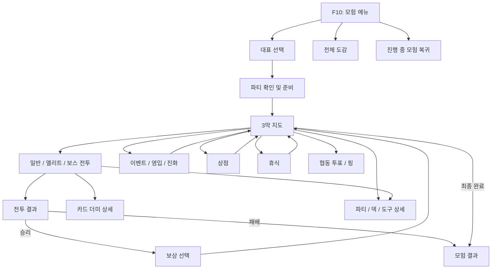

# UI 화면 구조와 설계안

이 문서는 현재 구현과 앞으로 필요한 화면을 구분한 설계안이다. 규칙의 확정 문서가 아니며, 미구현 기능의 수치와 보상은 실제 규칙 확정 후 연결한다. 기준은 `design/GDD-v4.2.md`와 `docs/ROADMAP.md`다.

## 화면 이동 구조



현재는 대표 선택, 도감, 단독 시험 전투와 카드 더미 화면이 있다. 지도, 협동, 보상 등은 미구현이다. 시험 전투의 현재 흐름을 유지하면서 이후 단계에서 연결한다.

## 공통 화면 원칙

- Minecraft 화면 위에 표시되는 패널을 사용하고, 제목·뒤로가기·닫기 위치를 통일한다. 닫기는 화면만 닫으며 진행 중 모험 종료와 구분한다.
- 중요한 정보는 색상뿐 아니라 숫자, 아이콘, 텍스트로 전달한다. 비활성 버튼에는 조건과 이유를 표시한다.
- 작은 GUI 배율에서는 정보 영역을 접거나 스크롤하고, 선택과 확정 버튼이 화면 밖으로 나가지 않도록 한다. 긴 이름은 축약하되 상세에서 전체를 보여준다.
- 선택 중, 서버 처리 중, 실패, 빈 목록, 연결 끊김 상태를 표시한다. 서버가 확정한 결과만 반영하고 중복 입력을 막는다.
- 한국어와 영어를 번역 키로 관리한다. 키보드 포커스와 선택 상태를 명확히 표시하고, 전투 단축키와 마우스 조작을 함께 제공한다.

## 1. 모험 메뉴와 대표 선택

**현재:** F10에서 검색, 기본 50종/확장 후보 전환, 대표 선택 및 도감 진입이 가능하다. 지원 불가 사유는 툴팁에 표시된다.

```text
┌ CobbleSpire ───────────────────────── 닫기 ┐
│ 새 모험     진행 중 모험 복귀                │
│ 검색 [                 ] [검색] [기본/확장] │
│ 후보 목록                 │ 선택한 대표 상세 │
│ [이름 · 타입] [이름 · 타입]│ 특성 / 지원 여부 │
│ [이름 · 타입] [이름 · 타입]│ 파티 구성 안내   │
│ 이전      페이지      다음 │ [대표 확인]      │
│ 전체 도감                                     │
└──────────────────────────────────────────────┘
```

후보 선택과 시작 확정을 분리해 실수를 줄인다. 상세에는 타입, 특성, 미지원 이유와 확장 후보의 균형 검증 여부를 표시한다. 파티 자동 구성 결과를 확인할 수 있는 준비 화면을 거쳐 시작한다. 협동이 구현되면 참가자별 준비 상태를 이 화면에 표시한다.

## 2. 도감과 파티 상세

도감은 검색과 페이지 이동이 가능한 목록과 종·폼 상세로 구성한다. 실제 등록 여부, 타입, 특성, 기술 및 지원 여부를 보여주며 미지원 효과는 이유를 명시한다. 파티 상세는 현재 체력, 상태, 덱, 도구와 진화 가능 여부를 탭으로 보여준다. 읽기 전용 정보와 실제 변경 버튼을 구별하고, 전투 중에는 해당 시점에 허용된 조작만 노출한다.

## 3. 전투

**현재:** 적 선택, 인텐트, 손패, 포켓몬 교체, 턴 종료, 더미 조회 및 서버 확정 이동 애니메이션이 연결되어 있다.

```text
┌ 전투 번호 · 라운드 · 현재 페이즈 ───── 닫기 ┐
│ [적: HP / 상태 / 다음 행동]  [적 ...] [소멸] │
│              선택 대상과 예상 결과              │
│ [뽑기 수]      전투 연출 영역                  │
│               [손패 카드 카드 카드]   [버림] │
│ 에너지   [파티 1] [파티 2] [파티 3] [턴 종료]│
└───────────────────────────────────────────────┘
```

적 인텐트와 선택 대상은 항상 보이게 한다. 카드 상세에는 비용, 효과, 대상, 강화·보존·소멸 여부와 사용 불가 사유를 표시한다. 예상 피해에는 급소 등 제외된 조건을 명시한다. 교체 시 손패가 버려지고 새로 5장을 뽑는다는 안내를 제공한다. 기절 교체, 처리 대기, 승리·패배는 별도 상태로 표시한다. 협동 전투에서는 각 참가자의 준비 및 행동 상태를 추가하되 개인 손패 공개 범위는 규칙 확정이 필요하다.

## 4. 카드 더미

뽑기·버림·소멸 더미를 각각 열어 카드 목록과 수량, 상세를 확인한다. 뽑기 더미는 남은 카드만 보여주고 순서는 공개하지 않는다. 닫으면 이전 전투 화면과 선택 상태로 돌아간다. 카드가 없을 때는 빈 상태를 명시한다.

## 5. 3막 지도와 협동 선택

```text
┌ 현재 막 · 진행 위치 ───── 파티 / 덱 / 도구 ┐
│                    [보스]                   │
│             [휴식]        [엘리트]          │
│       [상점]        [이벤트]                │
│             [현재 위치]                     │
│ 선택: 이벤트  │ 참가자 투표 2/4 │ [투표]   │
└─────────────────────────────────────────────┘
```

노드의 종류와 연결 경로를 아이콘과 텍스트로 표시한다. 도달 가능한 노드만 선택하고, 선택 시 위험과 알려진 보상을 설명한다. 협동에서는 참가자별 투표와 핑을 표시하고 확정 결과를 서버에서 받는다. 동률, 이탈, 재접속 시 처리 방식은 규칙 확정 전 미결로 둔다.

## 6. 전투 결과와 보상

결과 화면은 승패, 파티 상태 변화, 진행 점수를 보여준다. 승리 시 보상 화면에서 선택지의 효과와 현재 덱·파티에 미치는 영향을 비교한 뒤 확정한다. 선택 제한이나 건너뛰기 가능 여부는 실제 규칙에 따라 표시한다. 최종 결과는 진행한 막과 획득 내역을 보여주고 메뉴로 돌아가는 명확한 버튼을 제공한다.

## 7. 상점, 휴식, 이벤트 및 영입

- **상점:** 보유 재화, 상품 목록, 가격과 상세를 나란히 표시한다. 구매 전 비용과 결과를 확인하고 재화 부족이나 구매 불가 사유를 보여준다.
- **휴식:** 가능한 행동과 각 효과를 비교하고 대상 선택 후 확정한다. 이미 사용한 선택지는 상태를 표시한다.
- **이벤트:** 상황 설명과 선택지를 보여주고, 알려진 비용·결과와 불확실한 결과를 구분한다. 선택 후 서버 결과를 표시한다.
- **영입:** 후보 정보와 현재 파티를 비교한다. 파티가 가득 찬 경우 실제 규칙에 맞는 교체 또는 취소 절차를 제공한다.
- **진화:** 보유 권한과 가능한 원본 분기, 진화 전후 정보를 표시한다. 대상과 분기를 확인한 뒤 확정하며 실패 시 권한 보존 결과를 보여준다.

## 구현 순서와 검수

1. 기존 메뉴·전투·더미 화면의 작은 화면, 긴 번역 문자열, 조작 불가 이유와 재접속 상태를 검수한다.
2. 지도와 공통 파티 상세를 만들고, 서버 상태에 맞춰 노드 진입과 복귀를 연결한다.
3. 결과·보상, 상점·휴식·이벤트·영입·진화를 실제 규칙과 함께 순차 연결한다.
4. 협동 참가자 상태, 투표, 핑, 중복 입력과 연결 끊김을 검증한다.

각 화면은 최소·일반 GUI 배율, 빈 데이터, 긴 이름, 처리 실패 및 키보드 조작을 확인한다. 전투는 카드 이동 재생 중 입력, 손패 최대치, 무료 기절 교체와 더미 순서 비공개도 확인한다. 실제 게임 화면 검수 전에는 시각적 완성으로 간주하지 않는다.
