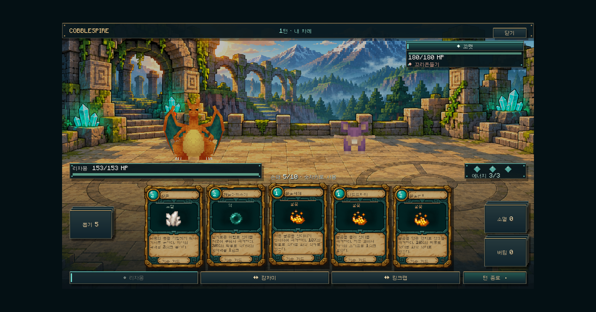
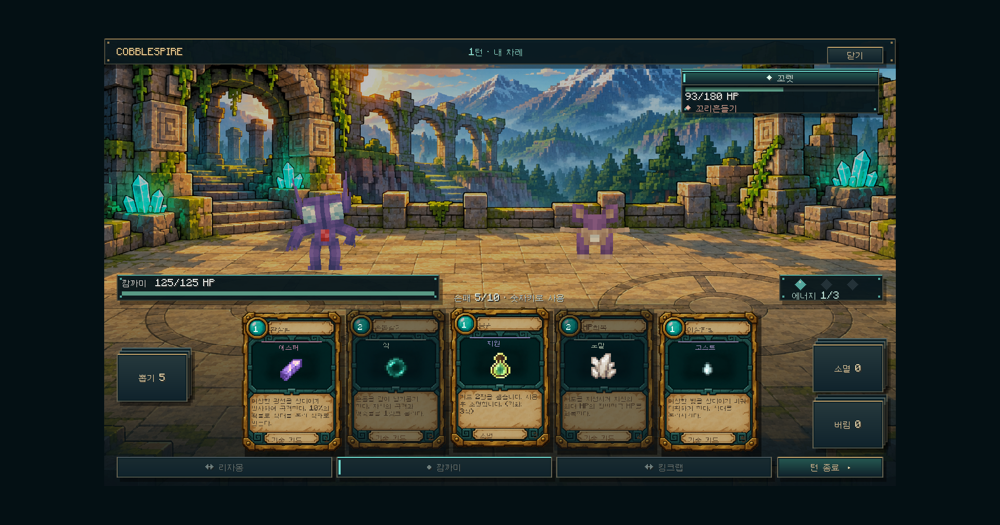

# 전투 화면 스킨 · 0.3.1-dev (이전 구현 기록)

현재 0.4.0-dev에서는 이 문서의 2D 전장 배경과 GUI 포켓몬 배치를 사용하지 않습니다. 실제 월드 전장과 분리 카메라는 [WORLD_ARENA.md](WORLD_ARENA.md)를 참고하세요. 카드/버튼 스킨만 유지합니다.

## 변경

- 화면 중앙에 별도 전장 배경과 실행 중인 Cobblemon 3D 모델을 표시합니다. 포켓몬이 배경 그림에 그려진 것은 아닙니다.
- 이름/HP/적 행동 예고/에너지를 별도 HUD로 나누고, 손패는 하단에 둡니다.
- 공통 버튼에 황동 테두리·청록색 호버/선택·비활성 상태·턴 종료 강조를 적용합니다.
- 카드에 비용 보석, 기술명, 타입, 타입별 마인크래프트 아이콘, 설명, 보존/소멸 표시를 배치합니다. 아이콘은 현재 타입 공통이며 기술별 전용 삽화는 아닙니다.
- 손패·이동 연출·덱 검사에 같은 카드 프레임을 사용합니다. 작은 창에서는 설명 전체를 호버로 확인합니다.
- 작은 창에서 소멸 덱과 에너지 HUD가 겹치지 않도록 더미 높이를 줄였습니다.

## 범위

독립 Screen 안의 전투 표현입니다. 실제 월드 경기장 생성, 월드 엔티티 전투 연출, 자유 카메라가 구현된 것은 아닙니다. 기존 서버 권한 전투와 5장 손패/교체/버림/소멸 규칙은 유지합니다. 실제 파티·PC·인벤토리는 변경하지 않습니다.

## 생성 이미지

내장 이미지 생성 도구로 새 텍스처를 만들고 프로젝트 리소스에 복사했습니다. 글자/숫자/포켓몬 모델/버튼은 게임에서 별도로 표시합니다.

- `src/main/resources/assets/cobblespire/textures/gui/card-frame-v1.png`
- `src/main/resources/assets/cobblespire/textures/gui/arena-v1.png`

### Card frame prompt

Create a production game UI asset: a single portrait blank collectible card frame, 2:3 aspect ratio, filling canvas with just a tiny transparent margin. Ink-outlined chunky pixel-adventure fantasy style consistent with Minecraft-inspired illustrated worlds. Weathered brass bevel outer frame, midnight teal carved stone, warm pale parchment lower description panel. A broad empty dark teal illustration window occupies the middle 45%, empty narrow parchment title banner near top, empty circular turquoise cost jewel at top-left, empty small bottom keyword ribbon. The entire illustration window should be flat dark teal, NOT transparent; only outside card transparent. Crisp legible simplified ornament at small display sizes, restrained corner rivets, strong dimensional edges. Absolutely NO letters, numbers, words, symbols, characters, creatures, logos or watermark. Flat front view, no perspective or mockup. This is a reusable texture that game code overlays dynamic text and icons on.

### Arena prompt

Production background texture for a Minecraft-inspired Pokemon card-battle game, panoramic 16:9 landscape. Empty ancient outdoor stone battle arena in a mountain ruin, viewed from a slightly elevated side angle. Large open flat sandstone tiled fighting floor occupies lower 65%, two faint circular stone battle markings at left 30% and right 70%. Background upper 35% has blocky ruined archways, turquoise glowing crystals, mossy stone columns, distant pine forest and hazy mountains. Warm brass sunlight against teal shadows. Stylized chunky voxel environment with bold ink outlines and textured shading, polished adventure game art, calm readable background not busy. All floor space clear for separately rendered 3D combatants. NO creatures, NO characters, NO HUD, NO cards, NO text, NO letters, NO numbers, NO logos, NO interface or frame. Fill entire image, no margin.

## 실제 실행 검증

53개 회귀 테스트와 빌드가 통과했습니다. 독립 개발 클라이언트에서 작은 창과 최대화 상태의 포켓몬 표시, 카드 사용 후 HP/에너지/손패 갱신, 리자몽→깜까미 교체 후 모델·손패 변경을 확인했습니다. 상세 수치는 `validation/ui-0.3.1.json`에 기록했습니다.

