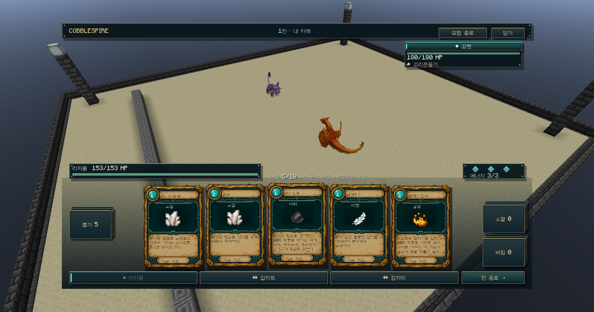

# 실제 월드 전장 · 0.4.0-dev

## 구현 범위

0.3.1-dev의 배경 이미지+GUI 포켓몬 배치를 대체했습니다. 카드 화면은 월드를 그대로 보여 주며, 별도 포켓몬 그림/모델을 Screen 안에 좌우 배치하지 않습니다.

- `cobblespire:arena` 전용 빈 차원에 49×41 블록 바닥·경계·조명·측면 관전 구역 생성.
- 각 1인 시험 세션은 분리된 경기장 좌표 사용. 아군은 현재 출전 1마리만 z=+6, 적은 z=-6에 수에 따라 중앙 정렬.
- 실제 서버 PokemonEntity를 사용하며 AI·중력·일반 전투·포획을 차단한 표시용 개체입니다. 서버 카드 전투 상태를 기준으로 생성·교체·기절 제거·HP 이름표 갱신.
- 작은 모델은 식별을 위해 표시 배율만 확대합니다. 판정 스탯·종족·HP·기술은 바꾸지 않습니다.
- 플레이어 몸은 전장 측면 관전 구역에 둡니다. 카드는 분리된 클라이언트 공중 카메라에서 조작하고, 닫으면 몸의 실제 시점으로 돌아갑니다. F10으로 복귀합니다.
- 방향키/Home과 좌상단 카메라 버튼으로 개인 시점 각도 조정/초기화. 작은 창에는 더 아래를 보는 기본 각도 적용.
- 전용 차원에서 블록 파괴/상호작용/아이템 사용/공격/피해를 차단하고, 표시용 개체 외 자연 스폰을 제거합니다.
- 원래 차원/좌표/방향을 월드의 `data/cobblespire-returns/<uuid>.json`에 먼저 기록합니다. 정상 종료/접속 해제/서버 종료 시 복귀하고, 다음 접속 때 남은 기록을 복구합니다. 실제 파티/PC/인벤토리는 변경하지 않습니다.
- 프로토콜 4: 서버와 클라이언트가 같은 개발 버전이어야 합니다. 새로운 차원은 서버 재시작 시 등록됩니다.

## 실제 확인

독립 개발 마인크래프트에서 실제 블록 경기장, 공중 시점의 리자몽/꼬렛, 측면 몸 시점으로 복귀, 카드 사용 후 꼬렛 HP 180→107을 확인했습니다. 아래는 F2로 저장한 게임 화면입니다.

서버 자동 검증은 `validation/stage4-native-checks.json`, 빌드 및 시각 검증 범위는 `validation/stage4.json`에 기록합니다. 검증용 모드는 배포 jar에 포함하지 않습니다.

## 현재 한계

현재는 **1인 시험 전장**입니다. 협동/공동 전장, 공격·피격 동작과 기술 이펙트, 월드 대상 직접 클릭, 가림 개체 반투명 처리, 의자, 최종 경기장 장식은 아직 연결하지 않았습니다. HP/적 의도와 대상 선택은 기존 HUD를 사용합니다.

최종 카메라 버튼과 작은 창 자동 각도 보정은 빌드 검증까지 했지만, 화면 도구의 `failed to activate captured window` 오류로 추가 실기 검증을 마치지 못했습니다. 위 캡처는 버튼 추가 전의 같은 월드 배치/기본 공중 시점입니다. 방향키 입력 자동 검증도 확정하지 않았습니다.

운영 서버/실제 Modrinth 프로필에는 적용하지 않았습니다. 검증은 별도 개발 클라이언트와 독립 시험 서버에서 진행했습니다.

최신 빌드에서 회귀 테스트 53개와 독립 서버 검사 24개가 통과했습니다. 강제 프로세스 종료 후 복구와 다인전은 아직 실기 검증하지 않았습니다. 시험 서버 종료 후 기존 모드 파일 복원까지 확인합니다.
